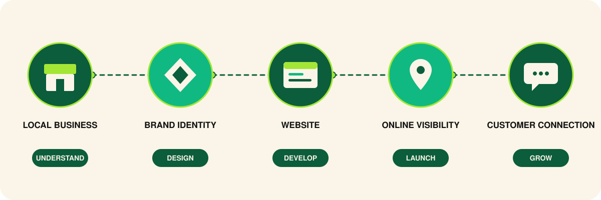

<div align="center">



# NayaDaur Digital

### Empowering Local Businesses. Building Digital Futures.

Helping local businesses become **visible**, **professional**, and **digitally connected**.

[](https://nayadaur.digital/)
[](https://github.com/MUdevelops/nayadaur.digital)
[](https://wa.me/923219211464)


</div>

---

## About NayaDaur Digital

NayaDaur Digital is an independent digital services brand that helps small and local businesses establish a credible presence online and grow with it.

Many neighbourhood shops, restaurants and service providers do great work but are hard to find online, or look less professional on screen than they do in person. NayaDaur Digital closes that gap. We handle the practical building blocks of a digital presence — identity, website, listings, social accounts, advertising and everyday business tools — so owners can stay focused on running their business.

**Who we serve:** shop owners, food businesses, small brands, home-grown startups and service providers who want a clear, professional and affordable way to go digital.

This repository contains the source code of the official website at **[nayadaur.digital](https://nayadaur.digital/)**.

---

## Our Mission



| Pillar | What it means for a local business |
| :-- | :-- |
| **Digital Visibility** | Being easy to find on Google, Maps and social platforms. |
| **Creative Identity** | A logo, colours and visuals that make the business memorable. |
| **Business Growth** | Online channels that bring in enquiries and repeat customers. |
| **Digital Opportunities** | Access to tools — ads, ordering, invoicing — once reserved for larger companies. |
| **Community Empowerment** | Strong local businesses make stronger local communities. |

---

## Our Services

### Brand & Design

| Service | Description |
| :-- | :-- |
| **Logo Design & Brand Kit** | A distinctive logo with colours and usage guidelines for consistent branding. |
| **Urdu / Bilingual Logo & Calligraphy** | Urdu and Urdu–English logos, with calligraphy that suits local audiences. |
| **Product Photography & Catalog Design** | Clean product visuals and printable or shareable catalogues. |
| **Menus, Banners & Packaging Labels** | Print-ready menus, shop banners and packaging labels. |
| **Canva Design Services** | Editable Canva templates for posts, flyers and everyday marketing. |

### Websites & Online Presence

| Service | Description |
| :-- | :-- |
| **Landing Pages & Frontend Websites** | Fast, mobile-friendly pages that present your business clearly. |
| **E-Commerce Store Development** | Online stores that let customers browse and order products. |
| **Google Business Profile Setup** | A complete listing so customers can find you on Search and Maps. |
| **Social Media Account Setup** | Professionally set-up, consistently branded business profiles. |
| **WhatsApp Business Setup** | Business profile, catalogue and quick replies for customer chat. |

### Marketing & Business Tools

| Service | Description |
| :-- | :-- |
| **Google Ads (Search & Maps)** | Targeted ads that reach people searching for your services nearby. |
| **Facebook & Instagram Ads** | Social campaigns aimed at your local audience. |
| **QR-Based Customer Review System** | A QR code that makes leaving a review quick and easy. |
| **Digital Invoice System** | Simple digital invoices to replace handwritten bills. |
| **Udhaar Management Solutions** | A clear way to record and follow up customer credit. |

---

## How We Work



| Step | What happens |
| :-- | :-- |
| **1. Understand** | We learn about your business, customers and goals. |
| **2. Design** | We shape your brand identity and the look of your online presence. |
| **3. Develop** | We build your website and set up the tools you need. |
| **4. Launch** | We go live, connect your profiles and make you easy to find. |
| **5. Grow** | We help you improve visibility and keep reaching new customers. |

---

## Website Features

<!-- VERIFY each item against the current codebase before publishing. -->

- **Responsive, mobile-first layout** that works across phones, tablets and desktops.
- **Clear service presentation** across dedicated pages.
- **WhatsApp as the primary contact action** for quick enquiries.
- **Direct contact details** — phone, WhatsApp and email.
- **Search-engine setup** with English page titles, meta descriptions and a favicon for search results.
- **Accessible, readable design** using the NayaDaur brand palette.

---

## Technology Stack

<!-- VERIFY: remove any badge for a tool that is not actually in package.json. -->

| Area | Technologies |
| :-- | :-- |
| **Frontend** |   |
| **Styling** |  |
| **Development tools** |    |
| **Hosting & deployment** |  |
| **SEO** | Meta tags, Open Graph, JSON-LD structured data, sitemap and robots.txt |

---

## Website Preview

Live site: **[nayadaur.digital](https://nayadaur.digital/)**

<!-- Add real screenshots to assets/readme/ (e.g. preview-desktop.png, preview-mobile.png) and reference them here. -->

---

## Project Architecture

<!-- VERIFY against the actual tree. -->

```text
nayadaur.digital/
├── react-app/          # React (Vite) source code
│   ├── public/         # Static files (favicon, robots.txt, sitemap)
│   ├── src/            # Components, pages and styles
│   └── package.json    # Scripts and dependencies
├── assets/
│   └── readme/         # Illustrations used in this README
├── (prebuilt site)     # Production build served on Hostinger
└── README.md
```

---

## Getting Started

### Prerequisites

- [Node.js](https://nodejs.org/) (current LTS recommended)
- npm (included with Node.js)
- Git

### Clone

```bash
git clone https://github.com/MUdevelops/nayadaur.digital.git
cd nayadaur.digital/react-app
```

### Install dependencies

```bash
npm install
```

### Run locally

```bash
npm run dev
```

Open the local address printed in the terminal (Vite defaults to `http://localhost:5173`).

### Production build

```bash
npm run build
npm run preview   # optional: preview the production build locally
```

---

## Deployment

The website is hosted on **Hostinger** at [nayadaur.digital](https://nayadaur.digital/).

1. Run `npm run build` inside `react-app/`.
2. Upload the contents of the generated build folder (normally `dist/`) to the site's `public_html` directory using Hostinger's File Manager or FTP.
3. Confirm that `robots.txt`, `sitemap.xml` and the favicon are present at the site root.

---

## SEO & Performance

<!-- VERIFY each item. Only list what exists in the repository. -->

- English page titles and meta descriptions on every page.
- Favicon configured for search results.
- Open Graph metadata for link sharing.
- JSON-LD structured data.
- `sitemap.xml` and `robots.txt`.
- Production builds are minified and bundled by Vite.

---

## Future Roadmap

These are **planned** improvements, not completed features.

- [ ] Portfolio section with real client work, shared with permission
- [ ] Customer testimonials, shared with permission
- [ ] Service-specific guides for local business owners
- [ ] Further performance and accessibility audits

---

## Contributing

Contributions that improve accessibility, performance or documentation are welcome.

1. Fork the repository.
2. Create a branch: `git checkout -b feature/your-improvement`
3. Make your changes and confirm `npm run build` succeeds.
4. Commit with a clear message and open a pull request describing what changed and why.

Please do not alter brand assets, contact details or business content without discussing it first.

---

## Contact & Connect

| | |
| :-- | :-- |
| **Website** | [nayadaur.digital](https://nayadaur.digital/) |
| **GitHub** | [MUdevelops/nayadaur.digital](https://github.com/MUdevelops/nayadaur.digital) |
| **WhatsApp** | [wa.me/923219211464](https://wa.me/923219211464) |
| **Phone** | 0321 9211464 |
| **Email** | [info@nayadaur.digital](mailto:info@nayadaur.digital) |

---

## License

See the [LICENSE](LICENSE) file in this repository for the terms that apply. If no license file is present, all rights are reserved by the repository owner.

---

## Brand Notice

> NayaDaur Digital is an independent digital services brand. It is not affiliated with, operated by, or endorsed by any government department or public authority.

<div align="center">

**NayaDaur Digital** — *Empowering Local Businesses. Building Digital Futures.*

</div>
